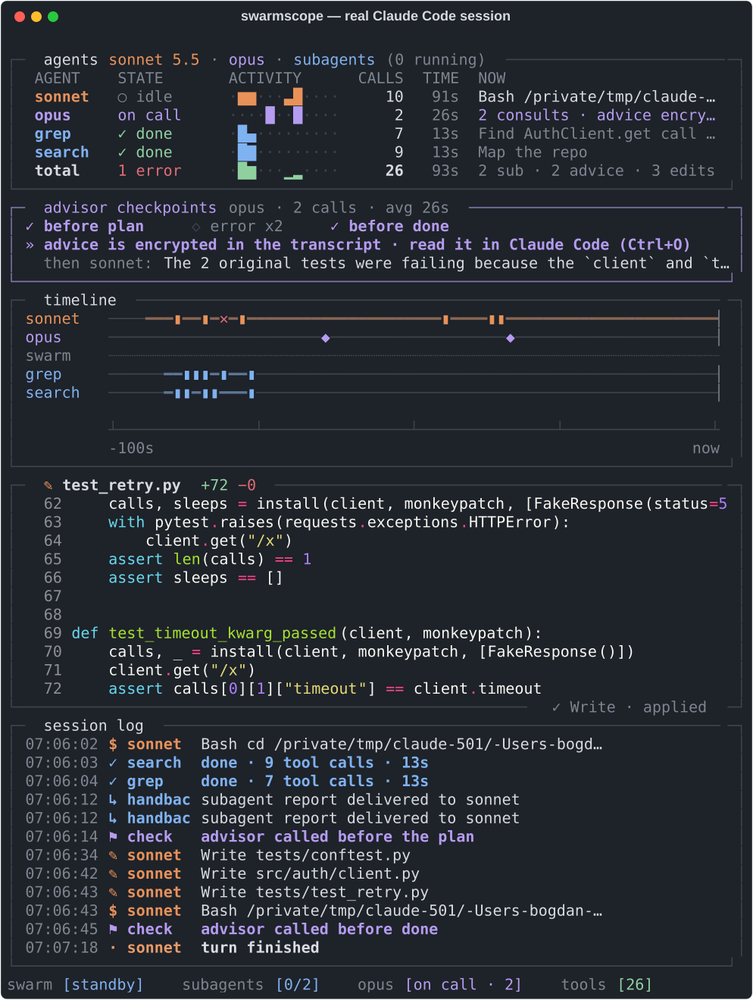

# Swarmscope

A live terminal dashboard for a Claude Code session where Sonnet writes the code, Opus sits on call as advisor, and subagents dig through the repo.



*Real session: Sonnet 5.5 lead, Opus 5.5 advisor, two read-only subagents. 91 s, 7 tests passing.*

## What it shows

- **agents**: one row per agent with state, activity over time, tool calls, duration and what it's doing right now
- **advisor checkpoints**: whether Sonnet called the advisor before the plan, after the same error twice, and before calling it done
- **timeline**: who worked when, with errors (`✕`) and advisor calls (`◆`) marked
- **live code**: the last edit, typed out with syntax highlighting
- **session log**: tool calls, errors, subagent hand-backs, advisor checkpoints

## Where the data comes from

- **Claude Code hooks** for tool calls, errors, edits and subagents (`hook.py` appends one JSON line per event).
- **The session transcript** for advisor calls. Hooks never see the advisor: it runs server-side.
- **Token usage in the transcripts** for the COST column (`costs.py`). Sonnet's usage comes from the main transcript and each subagent's from its own. The advisor's tokens are only in `usage.iterations[]` (`advisor_message`). Dollars are list-price estimates (edit `prices.json` in the swarmscope folder to change them). The total row also shows Claude Code's own `total_cost_usd` so you can compare. `~` marks an advisor figure estimated as a lower bound, used when the transcript has advisor calls but no advisor usage.

Check a past session: `python costs.py ~/path/to/project` (or a transcript `.jsonl`, or `--latest`).

Things it can't do:

- **Read the advice itself.** Claude Code stores it encrypted in the transcript (`advisor_redacted_result`). Swarmscope shows when the advisor was called, how long it took and what Sonnet wrote right after. Read the advice in Claude Code with Ctrl+O.
- **Enforce the checkpoints.** They are observations. Sonnet decides when to call the advisor.
- **Show real progress.** Activity bars count tool calls over time.

Tested on macOS with Claude Code 2.1.319 and 2.1.322.

## Install

Needs Python 3 and, for the side-by-side launcher, tmux.

```bash
git clone https://github.com/THEIAORGANON/swarmscope && cd swarmscope
./install.sh --dry-run   # shows the ~/.claude/settings.json diff, changes nothing
./install.sh             # backs up settings.json, adds hooks + statusLine, installs agents
```

`install.sh` copies the scripts to `~/.claude/swarmscope`, creates a venv with `rich`, merges the hooks into `~/.claude/settings.json` (your existing hooks stay) and replaces `statusLine`. The agents `search`, `grep` and `docs` (`model: haiku`, read-only tools) go to `~/.claude/agents/` unless files with those names already exist.

## Run

```bash
swarmscope                      # tmux: claude --model sonnet --advisor opus | dashboard
```

Or by hand, in two windows:

```bash
~/.claude/swarmscope/.venv/bin/python ~/.claude/swarmscope/dashboard.py   # dashboard, follows the newest session
claude --model sonnet --advisor opus                                      # your session
```

A terminal of about 80×53 fits everything.

`dashboard.py --demo` plays a scripted session, no Claude Code needed.

Useful flags: `--title`, `--window N` (timeline seconds), `--layout classic`.

## Policy engine (experimental, off by default)

`rules.py` checks three rules at every Stop and writes each decision to `decisions/<session>.jsonl`. Decisions show up in the session log with `⚑`.

- **R1 tests**: code changed, so a test run has to pass after the last change. "Passed" needs a success event plus a recognizable runner summary (`5 passed`, `OK`, `test result: ok`…). A clean exit without a summary, a masked exit code (`|| true`, a pipe) or an interrupted run is "unknown". If the output reports failures, the run counts as failed.
- **R2 repeat error**: the same normalised error showed up twice, the action never succeeded in between, and the advisor was not called.
- **R3 high risk**: 3+ source files, 50+ changed lines, or a critical path (auth, security, migrations…). It needs an advisor call after the code changed. If the change since the last call is high-risk on its own, it needs another one. Docs and test data don't count.

The changes come from the repo itself, not from tool calls. The engine snapshots the working tree when the session starts, after every tool call that can change files, and at Stop. New, staged, committed and Bash-made changes are all counted, along with when each one happened. Edits that were there before the session are not. Snapshots go to Swarmscope's own object store, so nothing is written into your repo. Untracked files that look like secrets (`.env`, keys, credentials) or are over 1 MB are never read. Without git, R1 and R3 say "skipped" instead of guessing.

Decisions that were put to Sonnet (enforce) get an `outcome`: observed, not_observed or unverified. All other decisions get a `followup`, which records what happened anyway and never counts as compliance.

Turn it on per project with `.claude/swarmscope-policy.json`:

```json
{"mode": "observe", "risk": {"min_files": 3, "min_lines": 50}, "test_command": "pytest -q"}
```

- `observe` logs decisions only.
- `advise` also shows them to you, not to the model.
- `enforce` sends Sonnet back to work with the reason.

Enforce blocks at most twice per turn and waits while background subagents run. If anything inside the engine fails, Claude stops normally. To see what a project will report before a live run, use `python rules.py --check <project>`: it shows the registered hook events, the policy mode, whether snapshots work and whether tests were found. Run the checks with `python -m pytest tests`.

## Prompting the advisor

Sonnet chooses when to call the advisor. This line in `CLAUDE.md` makes the three checkpoints more likely:

```md
Consult the advisor before locking a plan, after the same error shows up twice, and before calling a task done.
```

## Uninstall

Delete `~/.claude/swarmscope` and the three agent files, and restore `~/.claude/settings.json` from the `.bak` next to it.

## License

MIT
