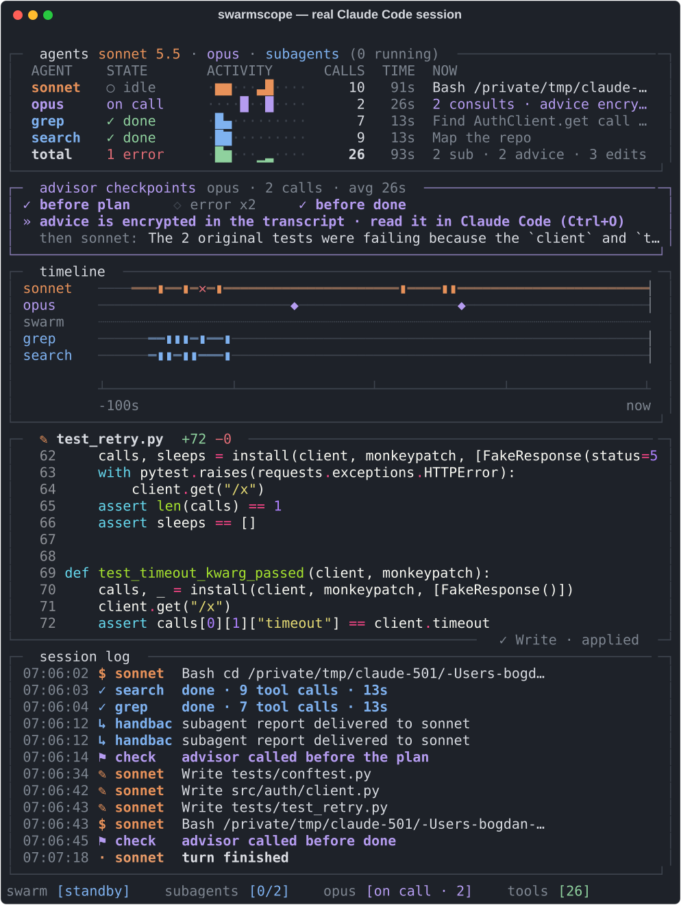

# Swarmscope

A live terminal dashboard for a Claude Code session where Sonnet writes the code, Opus sits on call as advisor, and subagents dig through the repo.



*Real session: Sonnet 5.5 lead, Opus 5.5 advisor, two read-only subagents. 91 s, 7 tests passing.*

## What it shows

- **agents**: one row per agent with state, activity over time, tool calls, duration and what it's doing right now
- **advisor checkpoints**: whether Sonnet called the advisor before the plan, after the same error twice, and before calling it done
- **timeline**: who worked when, with errors (`✕`) and advisor calls (`◆`) marked
- **live code**: the last edit, typed out with syntax highlighting
- **session log**: tool calls, errors, subagent hand-backs, advisor checkpoints

## Where the data comes from

- **Claude Code hooks** for tool calls, errors, edits and subagents (`hook.py` appends one JSON line per event).
- **The session transcript** for advisor calls. Hooks never see the advisor: it runs server-side.
- **Token usage in the transcripts** for the COST column (`costs.py`). Sonnet's usage comes from the main transcript and each subagent's from its own. The advisor's tokens are only in `usage.iterations[]` (`advisor_message`). Dollars are list-price estimates (edit `prices.json` in the swarmscope folder to change them). The total row also shows Claude Code's own `total_cost_usd` so you can compare. `~` marks an advisor figure estimated as a lower bound, used when the transcript has advisor calls but no advisor usage.

Check a past session: `python costs.py ~/path/to/project` (or a transcript `.jsonl`, or `--latest`).

Things it can't do:

- **Read the advice itself.** Claude Code stores it encrypted in the transcript (`advisor_redacted_result`). Swarmscope shows when the advisor was called, how long it took and what Sonnet wrote right after. Read the advice in Claude Code with Ctrl+O.
- **Enforce the checkpoints.** They are observations. Sonnet decides when to call the advisor.
- **Show real progress.** Activity bars count tool calls over time.

Tested on macOS with Claude Code 2.1.319 and 2.1.322.

## Install

Needs Python 3 and, for the side-by-side launcher, tmux.

```bash
git clone https://github.com/THEIAORGANON/swarmscope && cd swarmscope
./install.sh --dry-run   # shows the ~/.claude/settings.json diff, changes nothing
./install.sh             # backs up settings.json, adds hooks + statusLine, installs agents
```

`install.sh` copies the scripts to `~/.claude/swarmscope`, creates a venv with `rich`, merges the hooks into `~/.claude/settings.json` (your existing hooks stay) and replaces `statusLine`. The agents `search`, `grep` and `docs` (`model: haiku`, read-only tools) go to `~/.claude/agents/` unless files with those names already exist.

## Run

```bash
swarmscope                      # tmux: claude --model sonnet --advisor opus | dashboard
```

Or by hand, in two windows:

```bash
~/.claude/swarmscope/.venv/bin/python ~/.claude/swarmscope/dashboard.py   # dashboard, follows the newest session
claude --model sonnet --advisor opus                                      # your session
```

A terminal of about 80×53 fits everything.

`dashboard.py --demo` plays a scripted session, no Claude Code needed.

Useful flags: `--title`, `--window N` (timeline seconds), `--layout classic`.

## Window title

The dashboard sets the window title to `swarmscope · <project>`, where the project is the one the watched session runs in, not the dashboard's own folder. Set `SWARMSCOPE_BRAND=yourname` to get `yourname/swarmscope · <project>`, or pass `--title` to use your own text as is. In Terminal.app, turn off the extra title parts (Settings → Profiles → Window → Title) so only this title shows.

## Policy engine (experimental, off by default)

`rules.py` checks three rules at every Stop and writes each decision to `decisions/<session>.jsonl`. Decisions show up in the session log with `⚑`.

Files are classified once, the same way for every rule. **Production code** counts for R1 and R3. **Test code** (`tests/`, `test_*.py`, `*.spec.ts`…) counts for R1 only: changed tests must run, but they are not architectural risk. **Docs, test data and lockfiles** count for neither.

- **R1 tests**: code changed, so a test run has to pass after the last change. "Passed" needs a success event plus the runner's own summary (`5 passed`, `OK`, `test result: ok`…). If a pipe hides the exit code (`| tail`, `|| true`), the summary still counts. If the output went through `| grep`, the result is unknown.
- **R2 repeat error**: the same normalised error showed up twice, the action never succeeded in between, and the advisor was not called.
- **R3 high risk**: 3+ production files, 50+ changed production lines, or a critical path (auth, security, migrations…). It needs an advisor call after the code changed. After a consult only new risk counts: 3+ files or 100+ lines since the last call, or a critical file the advisor hasn't seen yet.

The rules can add escalations. They never stop Sonnet from calling the advisor on its own.

The changes come from the repo itself, not from tool calls. The engine snapshots the working tree when the session starts, after every tool call that can change files, and at Stop. New, staged, committed and Bash-made changes are all counted, along with when each one happened. Edits that were there before the session are not. Snapshots go to Swarmscope's own object store, so nothing is written into your repo. Stores older than 7 days are pruned. Files that look like secrets (`.env`, keys, credentials) or are over 1 MB are never read, whether git tracks them or not. The event log masks key=value secrets and common token formats, and doesn't record file contents written through heredocs. Without git, R1 and R3 say "skipped" instead of guessing. Snapshot and gate time is logged per session in `overhead/`.

Decisions that were put to Sonnet (enforce) get an `outcome`: observed, not_observed or unverified. All other decisions get a `followup`, which records what happened anyway and never counts as compliance. The live hook settles results at the next Stop. Once a session has ended, `python rules.py --finalize <session_id> <project>` closes whatever is still open. Running it again does nothing.

Turn it on per project with `.claude/swarmscope-policy.json`:

```json
{"mode": "observe", "risk": {"min_files": 3, "min_lines": 50}, "test_command": "pytest -q"}
```

- `observe` logs decisions only.
- `advise` also shows them to you, not to the model.
- `enforce` sends Sonnet back to work with the reason.

Enforce blocks at most twice per turn and waits while background subagents run. If anything inside the engine fails, Claude stops normally. To see what a project will report before a live run, use `python rules.py --check <project>`: it shows the registered hook events, the policy mode, whether snapshots work and whether tests were found. Run the checks with `python -m pytest tests`.

## Jev shadow mode (experimental, off by default)

Asks [Jev](https://openrouter.ai/docs/guides/community/jev.md), TypeSafe's decision model, whether consulting the advisor now would be worth its cost. It asks at every Stop, where the rules also decide. It only records the answer. It never changes a rules decision, blocks a Stop or tells Sonnet anything. Jev never sees the rules' verdicts, but it does get some of the same inputs (change size, critical files), so the two are independent algorithms, not independent data.

At each Stop the hook writes a DecisionContext to `jev/<session>.jsonl`, linked to that Stop's rules decision ids and holding the exact request that will be sent. Then it starts a detached worker that calls Jev and appends the answer. Claude Code doesn't wait for the network, only for the context to be written and the worker to start (logged as `jev_shadow_ms` in `overhead/`, ~15 ms on Linux, ~100 ms on macOS). Each context ends with one result: `ok` (probability, plus would-consult at the threshold), `invalid`, `model_mismatch`, `refusal`, `error`, `timeout`, `no_key` or `worker_failed`. If none arrives, `python jevshadow.py --finalize <session_id>` marks it `missing_result`. A missing answer never counts as "skip".

By default only counts and booleans are sent. Opt in for more: `include_task` (the current turn's request, 120 chars, redacted), `include_paths` (relative paths), `include_error_text` (80 chars, redacted). A runner can set `SWARMSCOPE_TASK_SUMMARY` to send its own task summary instead. Never sent: file contents, diffs, commands, the transcript.

```json
{"mode": "observe", "jev": {"enabled": true}}
```

Options: `model` (pinned, default `jev-1.14.0`), `threshold` (default 0.5, provisional: calibrate it on tasks you won't use to judge the policy), `timeout_s`, and the opt-ins above. The question is versioned (`q-consult-2`). Each record carries the model, question version and hashes of the question, the config and the request.

Key: put it in `typesafe_key` in the swarmscope folder (`chmod 600`), or set `TYPESAFE_API_KEY`. It is only ever sent to `https://api.typesafe.ai/v1/systemone`, and the project's config cannot change that. It is never written to events, decisions or Jev records. `python jevshadow.py --show <session_id>` prints, per checkpoint, which consult rules fired, whether that was applied, whether the advisor was then called, and what Jev said. `--replay <session_id>` sends the stored requests again, or the current question with `--current-question`. Replays are kept apart and never replace the original answers. `python jev_probe.py` makes a one-off test call.

## Lab runner (experimental)

`lab/lab.py` runs the escalation experiment one attempt at a time:
- a fresh copy of the task's base commit outside the home folder (no history, no remote, experiment files excluded);
- Claude Code with its own `CLAUDE_CONFIG_DIR` and an allow-listed environment, hooks passed with `--settings`;
- Bash in Claude Code's OS sandbox (home folder unreadable, writes only in the copy, no network), Read/Edit denied outside the copy;
- the policy and Jev settings come from a runner-side file (`SWARMSCOPE_POLICY_FILE`); the hook logs the sha of the policy it used;
- the session budget runs on a clock that counts the host's sleep; a session during which the host slept is invalid (`host_slept`), and on macOS the runner holds `caffeinate -i -s`;
- when the session ends, every process it started is stopped before the snapshot (process group, descendants, a run tag in the environment, processes with their cwd in the copy); a survivor or a failed process scan makes the run invalid. On Linux the runner is the subreaper of the session's orphans, so the stop is complete. **On macOS it is not a complete guarantee:** a process that clears its environment, leaves the copy and detaches before the next scan (about once a second) can stay invisible;
- tests run on separate copies of the final snapshot;
- one `run.json` per attempt, with `valid` (infrastructure), `session_status` and `verdict` kept apart.

```bash
python lab/lab.py setup                                  # then log in once with the printed config dir
python lab/lab.py doctor --ping --advisor-check          # CLI, isolation, real command line, one advisor call
python lab/lab.py probe                                  # boundary test: the agent tries to read/write outside
python lab/lab.py batch --task smoke1 --modes A,B --repeats 1 --seed 1
python lab/lab.py summary
```

Modes live in `lab/modes.json` (A = rules and Jev only record, B = Rules Engine b-5 enforces), tasks in `lab/tasks/`.
Every mode gets the same hooks, logs, sandbox and checks; only the policy differs.

## Prompting the advisor

Sonnet chooses when to call the advisor. This line in `CLAUDE.md` makes the three checkpoints more likely:

```md
Consult the advisor before locking a plan, after the same error shows up twice, and before calling a task done.
```

## Uninstall

Delete `~/.claude/swarmscope` and the three agent files, and restore `~/.claude/settings.json` from the `.bak` next to it.

## License

MIT
